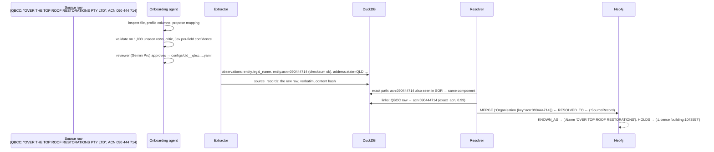
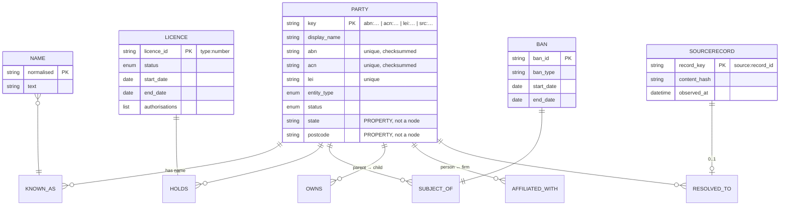

# Architecture

One sentence: **public registers go in, a resolved graph of Australian businesses comes out, and an
agent sits on top that either answers a question or hands you a stable table.**

## 1. The whole system

```mermaid
flowchart LR
    subgraph sources[Public sources]
        ABR[ABR bulk extract<br/>XML, 20M rows]
        ASIC[ASIC company register<br/>TSV, 3.4M rows]
        T2[ASIC licensees, bans,<br/>liquidators · GLEIF]
        T3[State registers<br/>QBCC, SOR, ACNC, contracts]
    end

    subgraph ingest[Agentic ingestion · src/firmable/ingest]
        SL[slices.py<br/>deterministic volume slice]
        AG[Onboarding agent<br/>inspect → map → validate → revise]
        RV[Model reviewer<br/>Gemini Pro approves/rejects]
        EX[Generic extractor<br/>config + file → observations]
    end

    subgraph store[Stores]
        DK[(DuckDB<br/>raw records · observations<br/>links · abstentions · flat views)]
        NEO[(Neo4j<br/>resolved graph:<br/>Party · Name · Licence · Ban · SourceRecord)]
    end

    subgraph resolve[Resolution · src/firmable/resolve]
        EXA[Exact path<br/>ABN / ACN / LEI, checksummed]
        SEM[Semantic path<br/>blocking → similarity → Jev P(same)]
        ARB{Arbitration<br/>identifier conflict wins}
    end

    subgraph agent[Retrieval agent · src/firmable/retrieval]
        RT[Router · Jev]
        IA[Intelligent agent<br/>tool loop, cites evidence]
        DR[Data retriever<br/>spec → preview → confirm → export]
        API[GraphAPI<br/>resolve · entity · ultimate_parent<br/>within_hops · read_cypher · projection]
    end

    ABR & ASIC --> SL --> AG
    T2 & T3 --> AG
    AG <--> RV
    AG -->|mapping config| EX --> DK
    DK --> EXA & SEM --> ARB --> DK
    DK -->|MERGE + reconcile sweep| NEO
    RT --> IA & DR
    IA & DR --> API
    API --> NEO & DK
    DEMO[Streamlit demo] --> RT
```

## 2. One record's journey



## 3. The graph model (what is a node, what is an edge)



Why each shape (full reasoning in `ontology/NOTES.md`):

| Thing | Shape | Because |
|---|---|---|
| Organisation, Person | two node labels under `Party` | a ban attaches to either; traversals must cross both; person names need a stricter match policy |
| Name | node | carries validity time and provenance; `resolve` searches every variant |
| Licence, Ban | nodes (reified) | they have their own status, dates, authorisations; "cancelled in the last 3 months" is a predicate on the licence |
| Ownership | edge with properties | one source (GLEIF) asserts it; promote to a node when a second source does |
| State, postcode, industry | properties | as nodes they would be hubs with 10^5–10^7 edges |
| SourceRecord | node; superseded versions kept in DuckDB history | a re-run re-points its single RESOLVED_TO edge and sweeps the old one → merges are undoable from `source_records_history` + `links` |

## 4. Two stores, and what each carries

| | Neo4j | DuckDB |
|---|---|---|
| holds | the resolved graph you traverse | raw rows, every claim, links, abstentions, flat views |
| good at | multi-hop traversal, "within N hops", ownership chains | joins/aggregation over millions of rows, blocking, exports |
| used by | `entity`, `ultimate_parent`, `within_hops`, `read_cypher`, resolve's name index | `projection` (Data retriever), resolution, evaluation |
| consistency | loaded **from** DuckDB; `party_attrs` is computed once in SQL and written to both | source of truth for raw data |

Keeping them consistent: the graph is a derived artefact of DuckDB. Each load `MERGE`s on unique
keys, stamps every node and edge with its `load_id`, then **reconciles**: anything derived that the
run did not stamp is deleted (`neo4j_loader.reconcile`). So after a record re-resolves from party A
to B there is exactly one `RESOLVED_TO`, and a party that merged away disappears — proven in
`tests/test_loader.py` against a scratch Neo4j. Nothing is written to Neo4j that is not first in
DuckDB. The first reconciling load of the shipped graph removed 28,461 stale Party nodes left by
earlier, non-reconciling loads.

## 5. The agent

```mermaid
stateDiagram-v2
    [*] --> route
    route --> clarify : P(specific) < 0.30
    clarify --> [*] : question with concrete options
    route --> intelligent : intent = answer | lookup
    route --> retriever : intent = dataset
    intelligent --> tools : resolve / entity / traversals / read_cypher (≤ 8 real calls, ≤ 90 s)
    tools --> intelligent : typed tools accept only resolved / chosen / shown keys
    tools --> halted : resolve says ambiguous or abstained (loop stops, code writes the reply)
    halted --> [*] : candidates listed, user picks a number → that key only
    intelligent --> [*] : answer + evidence + what it could not determine
    retriever --> spec : NL → ProjectionSpec; invalid columns/filters REJECTED (one repair round), never dropped
    spec --> preview : matched rows · export limit · 20 rows · restatement generated from the spec
    preview --> [*] : "reply yes to export"
    preview --> export : user confirms
    export --> [*] : CSV + Parquet + spec.json (as_of, data generation, matched/exported, hash)
```



What the code enforces versus what the prompt asks for (the distinction a reviewer should check):

| Guarantee | Enforced by | Proof |
|---|---|---|
| An ambiguous or abstained `resolve` ends the turn; the model cannot pick | `Agent.intelligent` returns on the decision; reply text is written by code | `tests/test_agent.py::test_ambiguous_resolve_halts…` |
| `entity` / `ultimate_parent` / `within_hops(of_key)` only on resolved, user-chosen or previously shown keys | key gate in `Agent._call`; Cypher rows never unlock keys | `…::test_typed_tools_refuse_keys…`, `…cypher_keys_are_not` |
| No entity lookup by name via Cypher, before or after a resolve: a name token (display_name, text, normalised, full-text index, toLower/toUpper) anywhere before the final RETURN is refused (WHERE, inline `{text: …}` maps, IN lists, WITH aliases, MATCH patterns), and inside RETURN when that clause filters (list comprehension, predicate function, CASE, comparison, map projection). Checked on comment-stripped text | `_name_filtered` gate in `Agent._call` | `tests/test_guards.py::test_name_lookups_are_refused_in_every_spelling`, `…::test_name_gate_applies_after_a_resolve_too` |
| Cypher cannot write: mutating keywords (CREATE, INSERT, MERGE, SET, DELETE, FOREACH, admin commands, USE) refused on comment-stripped text; procedures must be on an explicit read-only allowlist (`READ_PROCEDURES`), everything else by name is refused; the transaction is READ with a server-side timeout | `write_refusal` + READ access mode | `tests/test_guards.py::test_write_guard_refuses_every_mutating_form`, `…::test_comment_stripping_respects_string_literals` |
| `within_days N` is the N days up to and including `as_of`: dates after `as_of` are excluded | `_filter_clauses` | `tests/test_guards.py::test_within_days_is_really_two_sided_in_duckdb` |
| A graph-filtered export evaluates its graph predicate at the spec's pinned `as_of` (traversal edges and OWNS edges current at that date) | `GraphAPI._graph_keys(gf, as_of)` | `tests/test_guards.py::test_graph_filter_is_evaluated_at_the_saved_as_of` |
| A mapping the model reviewer still rejects on the final round fails the run; rounds are never converted into approval | `model_review` → `failed_review_rejected_after_max_revisions` → END | `tests/test_guards.py::test_final_round_rejection_fails_the_run…`, `…::test_failed_review_ends_the_graph_without_emit` |
| Tool budget = real calls and seconds, not loop iterations | `budget` counter | `…::test_budget_counts_real_calls…` |
| Invalid projection spec rejected, not narrowed; restatement derived from the validated spec | `GraphAPI.validate_projection`, `restate()` | `…::test_invalid_spec_is_rejected…`, `…restatement_is_generated…` |
| Export reports matched vs exported vs truncated; order total; `as_of` pinned; data generation stamped | `GraphAPI.projection` | `tests/test_graph_api.py::test_export_reports_matched…` |
| Cypher runs read-only under a server-side transaction timeout | `neo4j.Query(timeout)` + READ access mode + pattern guard | `…::test_cypher_timeout_is_a_transaction_timeout` |
| Graph = DuckDB state after any reload (no stale edges / parties) | `load_id` stamping + `reconcile` sweep | `tests/test_loader.py` |
| A re-ingested record supersedes, never deletes, its previous version | `source_records_history`, `observations_history` | `tests/test_store.py` |
| Still prompt-only | citing evidence in prose; "say what you could not determine"; preferring typed tools over Cypher | — |

Where Jev (TypeSafe decision model) is used, and why there and not elsewhere:

| Decision | Model | Why a decision model |
|---|---|---|
| Is this dataset about businesses? (triage) | Jev | a calibrated probability beats a generative model's self-reported 0.9 |
| Is this column→field mapping correct? | Jev | independent of the proposing model; feeds `field_confidence` |
| Are these two records the same party? | Jev | the number IS the link confidence; thresholds are set on it |
| What does the user want, and is it specific enough? | Jev | routing needs a probability, not prose |
| Write a mapping / an answer / a Cypher query | Gemini Flash | needs generated text |
| Approve a mapping, label a link | Gemini Pro | a stronger, different model as the second opinion |
