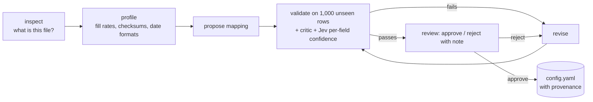

# Concepts — the ideas behind the system, in plain terms

This is the explainer to read before `ARCHITECTURE.md`. Each section is one idea, why it
matters for Firmable's problem, and where it lives in the code.

## 1. Observation ≠ fact

A source row is a **claim** made by a publisher at a point in time, not the truth. QBCC says a
licensee is at one address; ASIC says the company is at another; both are observations. We
never overwrite one with the other at ingest. We keep all of them, with who said it and when,
and reconcile **later**, with a rule we can change.

*Where:* `ontology/firmable_ontology.yaml` (the `observation` envelope every claim carries),
`outputs/observations/*.jsonl`, DuckDB `observations`.

## 2. Config beats code; the agent writes the config

Adding a source used to mean writing a parser. Here, **one engine** (`extractor.py`) reads a
**mapping config** that says "this column → this canonical field, through these transforms".
The configs are not written by a person: an **agent** inspects the file, profiles the columns,
proposes the mapping, runs the real extractor on 1,000 rows it has never seen, reads the
failures, revises, and only then asks for approval. The approval screen is the same whether a
human or the Gemini Pro reviewer reads it.

*Where:* `src/firmable/ingest/onboarding/`, `configs/*.yaml`, run reports in `outputs/onboarding/`.

## 3. Identifiers first, names last

An ABN or ACN is a government-issued key with a checksum. If two records share a valid ABN,
they are the same business, full stop. Names are evidence, never proof: "Commonwealth Bank of
Australia" and "Commonwealth Superannuation Corporation" share two words and nothing else.

So resolution has **two named paths** and a rule for when they disagree:

| Path | Evidence | Confidence |
|---|---|---|
| exact | same checksum-valid ABN / ACN / LEI | 0.99 |
| semantic | normalised names block together → string similarity → Jev gives P(same party) | Jev's probability |
| arbitration | two records carry *different* valid identifiers of the same kind | **never link**, whatever the names say |

*Where:* `src/firmable/resolve/resolver.py`, `outputs/links.jsonl` (match_type tells you which path).

## 4. Blocking: why we cannot compare everything with everything

193k backbone records × 300k attached records = 58 billion comparisons. Instead each record is
indexed under a few **blocking keys** (its distinctive name tokens; first-token + state;
postcode + first-token) and only records that share a key are compared. Generic tokens like
HOLDINGS, GROUP, TRUST are not keys, or every holding company would land in one block.

The price is **recall**: a record whose name has no token in common with its true match is never
compared. We measure that price by hiding identifiers and seeing whether the semantic path
rediscovers the exact match (`outputs/evaluation.md`).

*Where:* `src/firmable/resolve/normalise.py::blocking_keys`.

## 5. A wrong link is worse than no link → abstentions are a product

If the matcher is unsure, it does not guess. The record is written to the **abstention queue**
with the best candidate it saw, the score, and the reason (`below_threshold`,
`identifier_conflict`, `person_name_only`, `no_candidate_in_block`). The demo has a tab for
them. Sources where a wrong link publishes an accusation (ASIC bans) use a higher threshold.

*Where:* `outputs/abstentions.jsonl`, thresholds in `resolver.py::THRESHOLDS`.

## 6. Undoable merges

Thresholds get recalibrated; matchers improve. Two things make that safe:

1. **Source records never disappear.** The raw row sits in DuckDB and as a `SourceRecord` node;
   resolution only adds a `RESOLVED_TO` edge. Re-running changes edges, not records.
2. **Every link records its matcher version, threshold, score and evidence.** To recalibrate from
   0.85 to 0.90 you select links with `0.85 ≤ confidence < 0.90` and cut them — you do not
   re-run the corpus.

## 7. Calibrated decisions vs generated text (where Jev fits)

Generative models write good prose and bad probabilities: ask one how confident it is and it
says 0.9 whatever the truth. A **decision model** (TypeSafe Jev) is trained to return a
calibrated probability for a typed question (yes/no, choose one, score on a scale). We use it
wherever the *number* is the product:

- `P(dataset contains businesses)` → triage confidence
- `P(this column→field mapping is right)` → `field_confidence` on every observation
- `P(these two records are the same party)` → link confidence and thresholds
- `P(user's request is specific enough)` and *what kind of request* → routing and clarification

Generative models (Gemini Flash / Pro) still do the writing: mapping proposals, review notes,
answers, Cypher.

## 8. Two retrieval modes

**Intelligent agent** answers a question. It must resolve a name to an entity first; if the
graph offers two plausible entities, or none above threshold, the *code* stops the tool loop and
asks — the model never gets the chance to pick, and the typed tools refuse any key that was not
resolved, chosen by the user, or returned by an earlier tool. Every answer carries entity keys,
source records and match types, and ends with what it could not determine.

**Data retriever** builds a dataset. Natural language becomes a typed spec (base table, columns,
filters, optional graph predicate like "within 2 hops of a ban"); a spec naming a column that does
not exist is rejected (one repair round), never quietly narrowed. The user sees how many rows
match, how many the export will hold, a preview, and a restatement generated from the validated
spec; only on confirmation is a CSV + Parquet + `spec.json` written. The spec pins the `as_of`
date and the data generation, orders by a unique key, and the output is hashed, so the table is
**stable**: same spec, same generation, same bytes.

**Guiding the user** is the same mechanism in both: Jev estimates whether the request is
specific enough; if not, the agent asks one question with concrete options drawn from the
graph (real candidates, real columns, real time windows).

## 9. Validity time

A ban runs between dates. A licence is cancelled on a date. A former name was true for a
period. Edges and reified nodes carry `valid_from` / `valid_to`, and the loader keeps them, so
"what was true on date D" is a filter, not a rebuild. What is *not* there yet: point-in-time
snapshots of the backbone (ABR status history), which needs the weekly extracts kept as
versions — see `WRITEUP.md` §5.

## 10. What breaks at 15M companies

Blocking index memory first (it is a Python dict here; it becomes a DuckDB table keyed by
blocking key), then the Name node count, then Neo4j page cache for `within_hops` over hub
nodes. The write-up names each and the change it needs.
